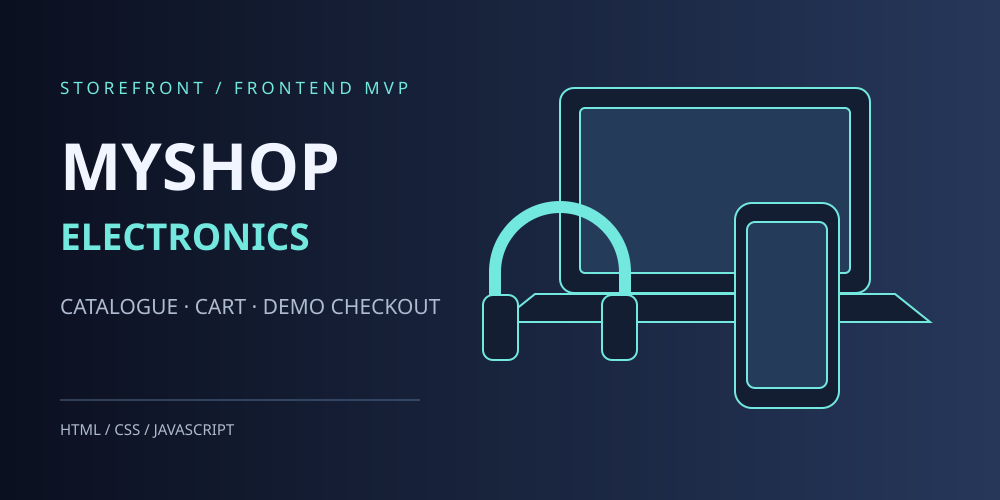

# MyShop Electronics



A responsive, multi-page electronics storefront prototype built with HTML, CSS and vanilla JavaScript. Originally developed as `shop-ecommerce`, it demonstrates catalogue browsing, cart management and basic storefront interactions without a backend.

**Status:** Functional frontend MVP. Not a production store; public deployment and browser end-to-end tests have not been verified.

## Features

- Seven sample electronics using the existing local product images
- Shared product catalogue with consistent prices
- Product search, category filtering and price sorting
- Persistent browser cart, item quantities, removal and order estimates
- Integer-cent price calculations; illustrative shipping ($9.99) and tax (8%)
- Optional demo display-name session without passwords
- Demo checkout and contact form with explicit no-submission notices
- Responsive layout, keyboard-accessible controls and accessible labels

## Run locally

Clone the repository, then run:

```bash
python -m http.server 8000
```

Visit http://localhost:8000. No package installation or API keys are needed.

## Project structure

- `index.html`: storefront and featured products
- `products.html`: searchable product catalogue
- `cart.html`: cart and order estimate
- `login.html`: optional demo profile
- `contact.html`: contact form demonstration
- `session-test.html`: session demo information
- `auth.js`: demo profile and contact interaction
- `cart.js`: catalogue, cart model and UI rendering
- `style.css`: responsive design
- `tests/cart.test.js`: cart and catalogue regression tests
- `assets/cover.svg`: original concept illustration for project listings

## Test

Node.js 18+:

```bash
node --test tests/cart.test.js
```

## Security and limitations

This is a static demonstration, not an authenticated or payment-enabled platform. The current source does not use a hardcoded login password. Previous commits may still contain old credentials; rotate them if they were ever reused elsewhere. Cart data is stored locally; the optional fictional display name is stored in the browser session. Do not enter real personal, payment or login information. Product specifications, prices and tax are examples, not verified offers.

## Roadmap

- Server-side catalogue and inventory
- Secure server authentication and authorization
- Validated backend checkout and payment provider integration
- Browser-level automated tests and deployment verification

No live URL is listed until it can be verified.
